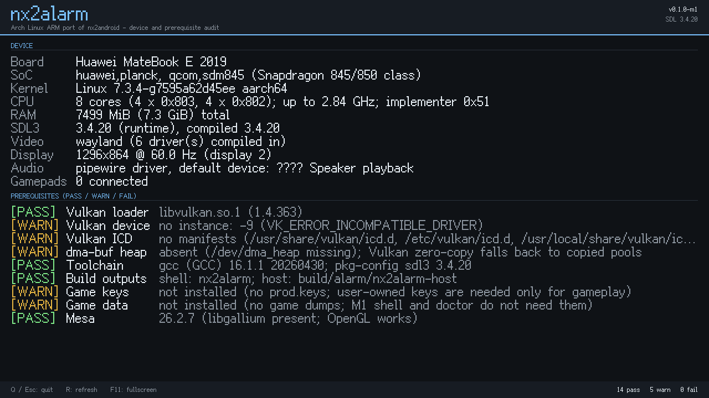

# nx2alarm

**Native Nintendo Switch game ports for Arch Linux ARM** — a compatibility layer that runs
the game's own arm64 code on an aarch64 Linux device, replaces the Switch's system services
with a host layer, and replays NVN graphics on Vulkan.

nx2alarm is a fork of **[nx2android](https://github.com/shirai91/nx2android)** (the Android
port of **[nxnative](https://github.com/seedds/nxnative)**, which does the same on Apple
devices). The engine — guest loader, Horizon HLE, NVN replay, rewriter, shader pipeline, game
profiles — is reused. The **platform layer is new**: SDL3 window/input/audio instead of
Android's NativeActivity/APK/AAudio/MediaCodec, and native aarch64 builds with gcc instead of
the Android NDK. The target device is a Huawei MateBook E 2019 (Snapdragon 850 / Adreno 630)
running Arch Linux ARM.

> **Status: M1 — shell + native host compile, delivered (2026-11-16).** This checkout does
> **not** play games yet. What works today on the target device (verified, see
> [`docs/M1_VERIFICATION.md`](docs/M1_VERIFICATION.md)):
>
> - `nx2alarm doctor` — device/prerequisite audit on Arch Linux ARM: 14 PASS / 5 WARN / 0 FAIL;
>   the WARNs are the real next prerequisites (Vulkan ICD missing, no dma-buf heap, no game data);
> - `nx2alarm shell` — a native SDL3 window shell with the audit rendered on screen (Wayland,
>   OpenGL renderer, screenshot mode, headless mode): 75 KiB binary, no Android tooling,
>   no Vulkan ICD needed;
> - `nx2alarm-host` — the upstream nxnative host core (182 C + 3 asm sources: Horizon HLE + NVN
>   layer + null graphics backend) compiled natively with gcc for aarch64 Linux and linked
>   without Android libraries: 7.7 MiB, starts and prints the upstream usage message;
> - the Linux platform layer (SDL3 audio, XDG saves, LAN, haptics, perf, assets) and a
>   compile-checked port of the Vulkan backend's surface/present and memory-pool edges
>   (9/9 sources with `-DDM_ALARM`), with no runtime test possible until a Vulkan ICD is installed.
>
> 
>
> Not yet: `porter` producing Linux ports, real gameplay, movies, on-screen gamepad. No game
> files, keys, Android NDK, .NET SDK or Vulkan ICD are present on the target machine, so M1
> stops at the shell and the host bootstrap. The path to playable games is in
> [`docs/PORTING_PLAN.md`](docs/PORTING_PLAN.md).

Read the plan: [`docs/PORTING_PLAN.md`](docs/PORTING_PLAN.md) ·
[`docs/ALARM_PORT.md`](docs/ALARM_PORT.md) (M1 contract) ·
[`docs/M1_VERIFICATION.md`](docs/M1_VERIFICATION.md) (M1 evidence) ·
[`docs/ALARM_ARCHITECTURE.md`](docs/ALARM_ARCHITECTURE.md) ·
[`docs/FEASIBILITY.md`](docs/FEASIBILITY.md) (device audit) ·
[`nxnative/dm/alarm/GFX_VK_PORT.md`](nxnative/dm/alarm/GFX_VK_PORT.md) (M2 Vulkan map).

## Quick start (on this device)

```sh
# The shell and the device audit (gcc + SDL3; no Android tooling):
python3 nxnative/dm/alarm/build.py --target shell
./build/alarm/nx2alarm version
./build/alarm/nx2alarm doctor
./build/alarm/nx2alarm shell --headless
./build/alarm/nx2alarm shell --frames 2 --screenshot /tmp/nx2alarm.ppm

# The host core, compiled natively for aarch64 Linux (null graphics backend):
python3 nxnative/dm/alarm/build_host.py
./build/alarm/nx2alarm-host          # prints the upstream usage: a game build dir is required
```

Requirements for M1: Arch Linux ARM, gcc (16 works), SDL3 (`sdl3`), pkg-config, Python 3.
For real play (M2/M3) you also need a Vulkan ICD for Adreno 630 (e.g. `vulkan-freedreno` from
the Arch Linux ARM repos, checked with `vulkaninfo`) and the game data you own.

## Why "ALARM"?

*Arch Linux ARM* is commonly abbreviated **ALARM**; `nx2alarm` is the counterpart of
`nx2android` for that platform.

## What the port reuses

The port is deliberate about what it keeps and what it replaces:

| Kept from nx2android | Replaced for Linux |
|---|---|
| Guest loader (arm64 NSO/NRO), Horizon HLE (`dm/host`), NVN layer and texture decoders (`dm/gfx`), rewriter and shader tools, game profiles, third-party libraries | Android NativeActivity/JNI/ANativeWindow front end → SDL3; AAudio → SDL3 audio; MediaCodec movies → V4L2 Venus / ffmpeg (M3+); AHardwareBuffer pools → dma-buf heaps or copy fallback; NDK build → gcc; APK/data pack → Linux app dir |

Details and a file-by-file map: [`docs/ALARM_ARCHITECTURE.md`](docs/ALARM_ARCHITECTURE.md).

## Repository layout

```
nxnative/dm/            the engine (fork of nxnative)
  dm/alarm/             NEW: the Arch Linux ARM platform layer (shell, doctor, build scripts,
                        native platform backends, Vulkan surface glue)
  dm/host/, dm/gfx/     reused host core (Horizon HLE, NVN, textures)
  dm/android/           the Android runtime (kept working; source of the port)
  dm/games/             game profiles
porter/, gui/           the porting pipeline and desktop GUI (Android target unchanged)
docs/                   upstream docs + nx2alarm docs (ALARM_PORT, ALARM_ARCHITECTURE,
                        PORTING_PLAN, FEASIBILITY)
```

## Licensing, keys and game files

- nx2alarm is **MIT**, as nx2native/nx2android are: see [`LICENSE`](LICENSE)
  (MIT, © 2026 seedds) and [`nxnative/LICENSE`](nxnative/LICENSE). Third-party code keeps its
  own license (Ryujinx, zstd, libvpx, Vulkan headers, fonts, …).
- Like nx2android, this repository contains **no keys, no game files, and nothing extracted
  from them**. You need your own dumped `prod.keys` and your own game files; the tool never
  downloads or ships them. Do not share the keys or ports built from them.
- Not affiliated with Nintendo. Whether decrypting your own games for your own use is allowed
  depends on where you live.

## Credits

- [nx2android](https://github.com/shirai91/nx2android) (MIT) — the Android port this project
  forks; engine, pipeline, profiles and docs.
- [nxnative](https://github.com/seedds/nxnative) (MIT) — the original ntnative host engine
  for Apple devices.
- [Ryujinx](https://github.com/Ryujinx/Ryujinx) (MIT) — shader translator and common code.
- The upstream `README` for nx2android is preserved at
  [`docs/UPSTREAM_README_nx2android.md`](docs/UPSTREAM_README_nx2android.md); the upstream
  architecture and development docs remain in `docs/`.
